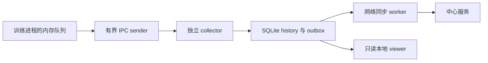

# 持久化、保留与恢复

collector 是 RunStore 唯一写入者，以进程锁保护一个 logdir。SQLite 使用 WAL、FULL 同步与有界批次。媒体复制和网络同步各在独立 worker 中；网络请求不持有源库读事务。



collector 在没有连接且空闲 30 秒后退出。已提交的 history 和待上传记录保留，后续 SDK 或 CLI 可重新启动 collector。

## 两种独立策略

| 选项 | 默认 | 行为 |
| --- | --- | --- |
| `sync="off"` | 是 | 本地记录，不创建待上传引用 |
| `sync="background"` | 否 | 持续尝试上传；网络故障不阻塞训练热路径 |
| `retention="record"` | 是 | ACK 只清除 outbox 引用，保留 history 与媒体 |
| `retention="cache"` | 否 | 回收已 ACK 的 event 与不再引用的已上传媒体；本地覆盖可能不完整 |

`off+cache` 被拒绝。手工 sync 只为仍保留且未确认的历史建立引用，不能恢复已回收的 cache 数据。

身份 `(run,session,producer,seq)` 与 event 时间/正文固定重发；丢失 ACK 可安全重试。不同正文重用同一身份会报冲突，不覆盖历史。媒体 UUID 和内容也保持不可变。

## 配额与边界

默认每 run 2 GiB 逻辑预算、每 store 10 GiB 物理预算、64 MiB WAL 检查预算。增量计数与 event 提交在同一事务中；物理容量探测和 checkpoint 在批次间摊销。配额/磁盘失败拒绝新写入，保留旧数据；单次事务或复制可能暂时超出目标。

尚未验证网络文件系统、Windows collector、跨主机共享 spool、大媒体压力和百万点交互性能。当前没有独立历史时序库或多分辨率索引。训练进程退出、主机掉电或文件系统故障可能丢失未提交事件。

## 常见恢复步骤

| 症状 | 检查与处理 |
| --- | --- |
| receipt 未接受 | 看 `reason`，减小 event/字段量或队列压力；被丢弃事件不能从 store 恢复 |
| finish 本地超时 | 看 `durable`、`collector_rejected` 与 `last_error`；保持进程存活可继续排空 |
| collector 崩溃 | sender 自动重新发现/启动；仍在内存的 inflight 按相同身份重发 |
| 远端断网/拒绝 | 本地数据保留；修复地址、key 或权限后手工 sync |
| 事件已 ACK，remote 未完成 | 查看 `sync_errors`；终态或元数据仍未发布，不能仅按 pending event 数判断 |
| 身份/远端绑定冲突 | 使用原正文/目标重试，或显式迁移为新 run；不要改库或重新编号冒充成功 |
| 配额/磁盘满 | 增加可用空间并保留旧 store；不会自动删除 `record` 历史 |

```sh
outputs/client-venv/bin/mlboard status ./outputs/mlboard-runs
outputs/client-venv/bin/mlboard sync ./outputs/mlboard-runs --timeout 30
```

诊断日志位于 `<logdir>/diagnostics/collector.log`，密钥不持久化到事件或诊断。collector endpoint 文件含本机 IPC 凭据，不应公开。

不要把活跃 SQLite 主文件单独复制当作完整备份。SQLite 的 backup API 可生成数据库快照，但完整 RunStore 还需一致的不可变媒体。当前没有完整 RunStore 备份 CLI；需要目录副本时，先使训练达到本地完成、等待 collector 退出并确认无写入者，再连同 `media/` 保留整个目录。保留原 store，先在新目录验证恢复。
